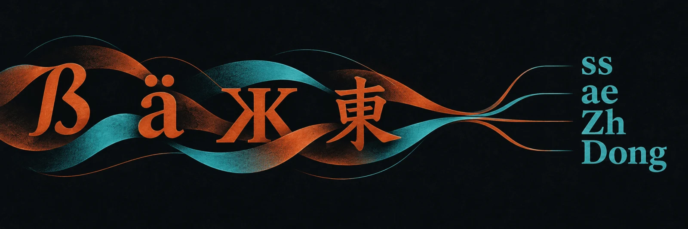
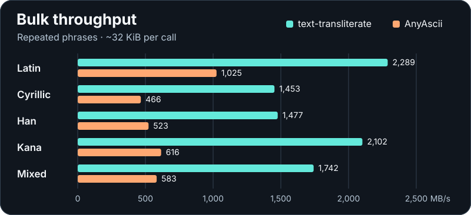
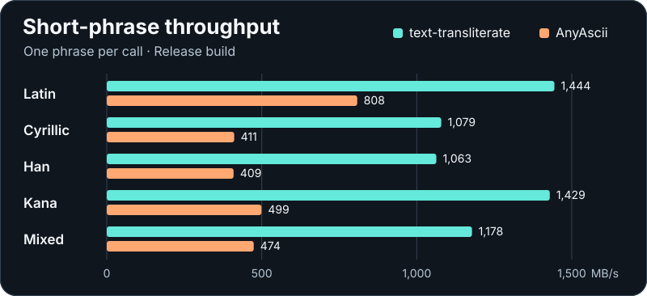

# text-transliterate



**Unicode to ASCII, with locale rules that preserve spellings like `Grüße → Gruesse`.** Convert text in one synchronous call. The tables ship with the crate, so the same build uses the same rules on every platform. Runs in safe Rust with zero runtime dependencies and supports `no_std` with `alloc`.

## Quick start

```rust
use text_transliterate::transliterate;

assert_eq!(transliterate("Straße · Привет · 你好"), "Strasse . Privet . NiHao");
```

`transliterate` uses the neutral profile and returns `Cow<str>`. ASCII passes through as a borrowed slice, with zero output allocation. Choose a locale when spelling conventions matter.

```rust
use text_transliterate::Transliterator;

let german = Transliterator::new("de-DE").unwrap();
assert_eq!(german.transliterate("Grüße aus Köln"), "Gruesse aus Koeln");
assert_eq!(german.transliterate("a\u{0308}"), "ae");
```

The German rules handle both `ä` and the decomposed sequence `a` plus a combining diaeresis. The neutral profile maps both to `a`. Reuse a `Transliterator` to resolve the locale once.

## Choose how to convert

### Reject unmapped input

```rust
use text_transliterate::try_transliterate;

let error = try_transliterate("Straße\u{10FFFF}").unwrap_err();
assert_eq!(error.character, '\u{10FFFF}');
assert_eq!(error.byte_offset, "Straße".len());
```

Strict conversion reports the first unmapped Unicode scalar and its UTF-8 byte offset in the original input. Known deletion rules still succeed. Regular conversion uses `?` for unmapped scalars by default. Set `with_unmapped(Unmapped::Drop)` to skip them.

### Write into a buffer or sink

```rust
use text_transliterate::Transliterator;

let mut output = String::from("City = ");
let german = Transliterator::new("de-DE").unwrap();
german.write_transliteration("Köln", &mut output).unwrap();
assert_eq!(output, "City = Koeln");
```

`write_transliteration` appends to any `core::fmt::Write` sink, including fixed-capacity buffers, without building an intermediate string. Sink errors propagate and any output already accepted stays in the sink. Use `transliterate_into` when you have a reusable `String`.

### Override spellings with your own rules

```rust
use text_transliterate::Transliterator;

let rules = [("ACME™", "Acme"), ("™", ""), ("ä", "ae")];
let custom = Transliterator::default().with_rules(&rules).unwrap();
assert_eq!(custom.transliterate("ACME™ in Växjö™"), "Acme in Vaexjo");
```

Rules are borrowed from the caller. At each input position, custom rules run before bundled rules, the longest match wins, and the first rule breaks ties. Replacements must be ASCII and can be empty to delete a match. Each replacement is emitted once. The configured converter supports owned-or-borrowed, strict, and sink output.

## Throughput

The neutral `transliterate` function delivered **2.2–3.4×** the bulk throughput of AnyAscii 0.3.3 and **1.8–2.9×** on short phrases. Both produced byte-for-byte identical output on these five corpora. Values are decimal MB/s of UTF-8 input.





<details>
<summary>Benchmark numbers and reproduction commands</summary>

| Sample | Bulk text-transliterate | Bulk AnyAscii | Short text-transliterate | Short AnyAscii |
| --- | ---: | ---: | ---: | ---: |
| Latin | 2,289 | 1,025 | 1,444 | 808 |
| Cyrillic | 1,453 | 466 | 1,079 | 411 |
| Han | 1,477 | 523 | 1,063 | 409 |
| Kana | 2,102 | 616 | 1,429 | 499 |
| Mixed | 1,742 | 583 | 1,178 | 474 |

Release builds on one logical CPU of an AMD Ryzen 9 8945HS running Linux, using Rust 1.100.0. Each value is the median of three runs, each with seven interleaved timing samples. The bulk run repeats each phrase to approximately 32 KiB. The short run measures one phrase per call. The harness also measures ASCII and German locale cases and compares other libraries. It flags any output differences.

```sh
cargo run --release --locked --manifest-path benchmarks/compare/Cargo.toml
SHORT=1 cargo run --release --locked --manifest-path benchmarks/compare/Cargo.toml
VERIFY=1 cargo run --release --locked --manifest-path benchmarks/compare/Cargo.toml
```

Verification compares every Unicode scalar against the original v3 engine in all distinct locale profiles, through the return-value, append, and sink APIs.

</details>

## Choose your tables

The default build includes all locale profiles and supplementary scripts. With default features off, the shared glibc table remains available. Enable the language and script data you need.

```toml
[dependencies]
text-transliterate = { version = "3", default-features = false, features = ["de", "ru"] }
```

`de` enables German spellings, `ru` enables Cyrillic romanization, and `ja` enables Japanese glibc rules plus the kana and Han tables. When a locale needs an omitted override, the error names the required Cargo feature. Locale identifiers include `de-CH`, `de_DE.UTF-8`, and `sr_RS@latin`.

You can also select scripts directly with `script-latin`, `script-cyrillic`, `script-greek`, `script-arabic`, `script-hebrew`, `script-han`, `script-kana`, `script-hangul`, `script-indic`, `script-southeast-asian`, `script-ethiopic`, `script-armenian`, `script-georgian`, `script-symbols`, and `script-other`. `all-scripts` enables every supplementary table.

The crate requires `alloc` support. The sink conversion itself performs no heap allocations. CI checks both full and minimal builds on bare-metal ARM.

## Coverage and table sources

The bundled GNU libc 2.43 data includes ordered alternatives, deletion rules, and multi-character sequences such as Ukrainian `зг → zgh`. The generator resolves locale inheritance and prefers the first direct ASCII replacement. It can also fold some non-ASCII replacements using the enabled tables.

Supplementary AnyAscii mappings cover scripts with gaps in the glibc rules. They provide per-character approximations, including **`Привет → Privet`**, **`你好 → NiHao`**, and **`かな → kana`**. ASCII output is suitable for tasks such as search indexing, slug generation, and legacy exports. Readings can depend on context, and distinct inputs can have identical output.

The Rust source is available under MIT or Apache-2.0. The pinned data, upstream notices, and regeneration instructions are documented separately. [Table sources and licenses](data/source/README.md)

## Upgrading from 2.x

`TextTransliterate::new().transliterate(text, locale)` still returns an owned `String`. The off-thread API and Cargo feature were removed in 3.x. Errors describe locale selection, and supplementary script data can produce different output from a host’s glibc.
